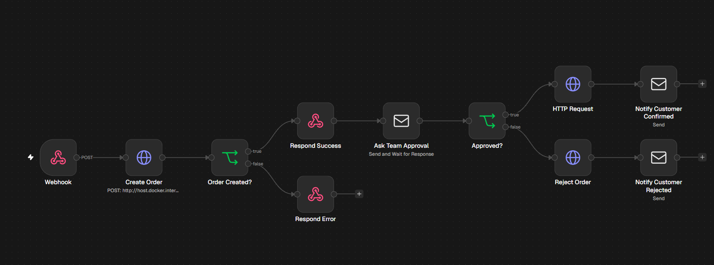
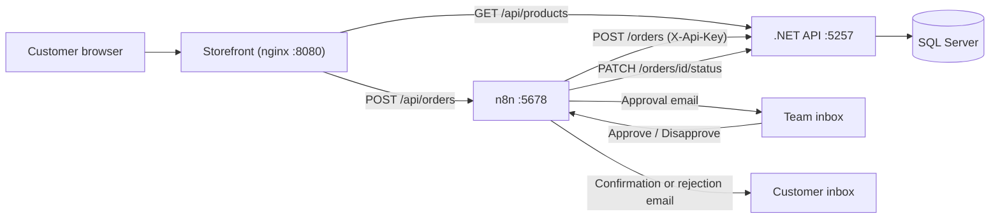

# n8n + .NET Order Intake Automation

End-to-end order automation for a small online store: a customer places an order on a web form, an n8n workflow creates it through a .NET API, the team approves or rejects it with one click by email, and the customer is notified automatically.

It replaces the manual routine of reading order emails, checking prices, typing them into a spreadsheet and replying to each customer by hand.

> **Demo video:** _coming soon_



## How it works

1. The customer picks products and submits the order on the storefront.
2. n8n receives the order through a webhook and calls the .NET API.
3. The API validates the request, prices every item from the database and stores the order as `Received`. The customer gets an immediate answer.
4. n8n emails the team with the order details and **Approve** / **Disapprove** buttons, then pauses until someone answers.
5. Based on the decision, n8n updates the order to `Confirmed` or `Rejected` through the API.
6. The customer receives a confirmation or rejection email.



## Tech stack

| Layer | Technology |
|---|---|
| Workflow automation | n8n (webhook, HTTP Request, If, Send Email with human approval) |
| Backend | ASP.NET Core Minimal API on .NET 10 |
| Data access | Dapper + Microsoft.Data.SqlClient |
| Database | SQL Server (Express works) |
| API docs | OpenAPI + Scalar |
| Storefront | Plain HTML, CSS and JavaScript served by nginx |
| Local email | Mailpit |
| Infrastructure | Docker Compose |

## Project structure

```
.
├── database/                 SQL scripts (schema and seed data)
├── docs/images/              Screenshots used in this README
├── n8n/workflows/            Exported n8n workflow
├── nginx/                    nginx config for the storefront
├── samples/                  Sample order payloads for testing
├── src/
│   └── OrderIntake.Api/
│       ├── Data/             Connection factory
│       ├── Dtos/             Request and response contracts
│       ├── Endpoints/        Minimal API route definitions
│       ├── Filters/          API key endpoint filter
│       ├── Models/           Database rows and domain constants
│       ├── Repositories/     SQL queries with Dapper
│       ├── Transformers/     OpenAPI security scheme
│       └── Validators/       Request validation rules
├── web/                      Storefront page
└── docker-compose.yml        n8n, Mailpit and storefront
```

## API endpoints

| Method | Route | Auth | Description |
|---|---|---|---|
| GET | `/health` | None | API and database status |
| GET | `/products` | None | Active products |
| POST | `/orders` | API key | Creates an order (`Received`) |
| GET | `/orders/{id}` | API key | Order details |
| PATCH | `/orders/{id}/status` | API key | Moves an order to `Confirmed` or `Rejected` |

Interactive documentation is available at `http://localhost:5257/scalar` when running in Development.

## Getting started

### Prerequisites

- [Docker Desktop](https://www.docker.com/products/docker-desktop/)
- [.NET 10 SDK](https://dotnet.microsoft.com/download)
- SQL Server (Express or Developer) and a client such as SSMS

### 1. Create the database

Run the scripts in order against your SQL Server instance:

1. `database/01-schema.sql` (creates the `OrderIntake` database and tables)
2. `database/02-seed.sql` (inserts sample products)

### 2. Configure and run the API

The connection string and API key are stored with [User Secrets](https://learn.microsoft.com/aspnet/core/security/app-secrets), so they never end up in the repository.

```powershell
cd src/OrderIntake.Api

dotnet user-secrets set "ConnectionStrings:OrderIntake" "Server=.\SQLEXPRESS;Database=OrderIntake;Trusted_Connection=True;TrustServerCertificate=True;Connect Timeout=5;"
dotnet user-secrets set "ApiKey" "<choose-a-random-key>"

dotnet run --launch-profile http
```

Adjust the server name to match your instance. Check `http://localhost:5257/health`, which should return `"database": "ok"`.

### 3. Start the containers

From the repository root:

```powershell
docker compose up -d
```

| Service | URL |
|---|---|
| Storefront | http://localhost:8080 |
| n8n | http://localhost:5678 |
| Mailpit (local inbox) | http://localhost:8025 |

### 4. Import the n8n workflow

1. Open n8n, create the owner account and import `n8n/workflows/order-intake.json`.
2. Create two credentials:
   - **Header Auth**: name `X-Api-Key`, value = the API key from step 2.
   - **SMTP**: host `mailpit`, port `1025`, SSL/TLS off, any user and password.
3. Assign the Header Auth credential to the `Create Order`, `Confirm Order` and `Reject Order` nodes, and the SMTP credential to every email node.
4. Publish the workflow.

### 5. Try it

1. Open the storefront at http://localhost:8080 and place an order.
2. Open Mailpit at http://localhost:8025 and click **Approve** or **Disapprove** in the team email.
3. A confirmation or rejection email arrives for the customer, and the order status changes in the database.

You can also call the webhook directly with the sample payloads:

```powershell
curl.exe -i -X POST http://localhost:5678/webhook/order-intake -H "Content-Type: application/json" --data-binary "@samples/order-success.json"
```

| Sample | Expected result |
|---|---|
| `order-success.json` | `201 Created` with the order |
| `order-unavailable-product.json` | `422` listing the unavailable SKUs |
| `order-invalid.json` | `400` with field validation errors |

## Design decisions

- **Prices always come from the database.** The request only carries SKUs and quantities, so a client cannot submit its own prices.
- **Unit prices are stored on each order item.** Changing a product price later never changes the value of past orders.
- **Customers are identified by email.** Orders work as guest checkout: the first order creates the customer, later orders reuse it. A unique constraint and an `UPDLOCK, HOLDLOCK` lookup prevent duplicates under concurrent requests.
- **Order creation is a single transaction.** Customer, order and items are written together or not at all.
- **n8n orchestrates, the API enforces the rules.** The workflow decides who approves and who gets notified. The API only allows `Received` to become `Confirmed` or `Rejected`, and the check happens inside the `UPDATE` statement, so two simultaneous decisions cannot both win. A second decision returns `409 Conflict`.
- **The customer gets an answer immediately.** The webhook responds before the approval step, so nobody waits for a human to click a button.
- **Order endpoints require an API key.** The key is compared in constant time, and the n8n workflow export contains only a credential reference, never the key itself.
- **The browser never talks to the API or n8n directly.** nginx serves the storefront and proxies both calls from the same origin, which avoids CORS configuration and keeps internal services out of the browser.
- **Explicit SQL with Dapper.** The schema is managed by hand-written scripts, and queries are visible and reviewable instead of generated.

## Going to production

This repository is a local demo. A production setup would also need HTTPS, a real SMTP provider, secrets in a vault or environment variables, rate limiting on the public endpoints and a timeout path for approvals that never get answered.

## Author

**Ariel Morais**: .NET developer focused on business process automation.

[LinkedIn](https://www.linkedin.com/in/ariel-morais) · [GitHub](https://github.com/arielm11)
